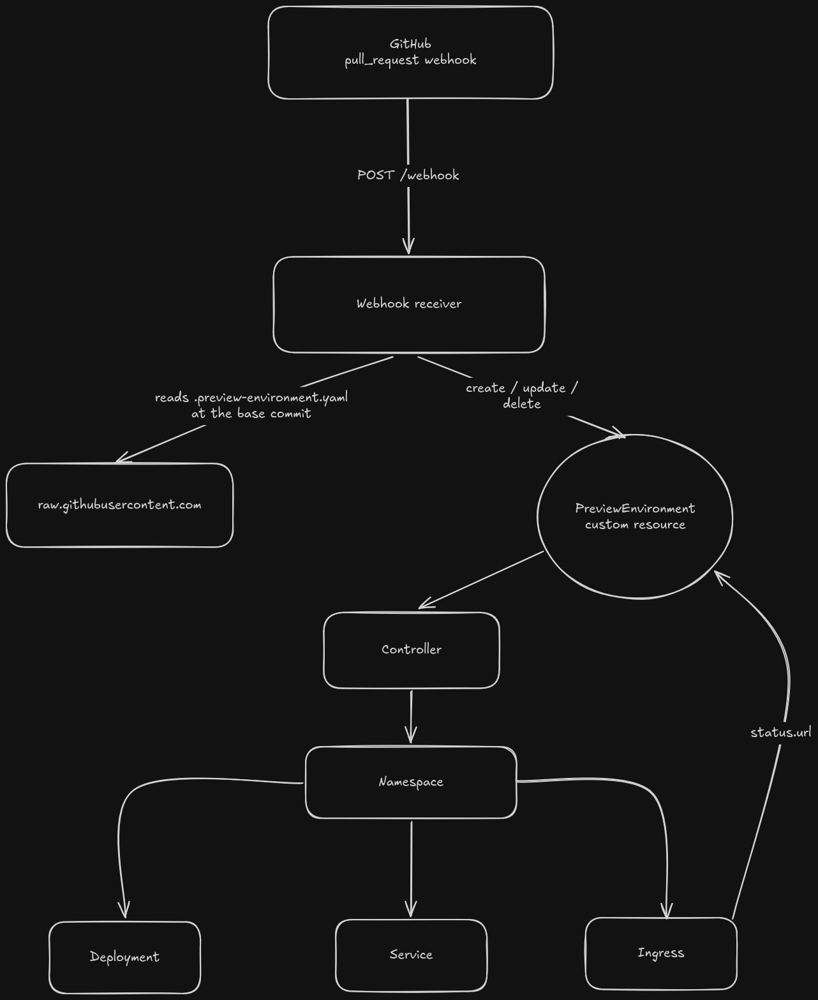

# pr-env

[](https://github.com/seppys/pr-env/actions/workflows/test.yml)
[](https://github.com/seppys/pr-env/actions/workflows/lint.yml)
[](https://github.com/seppys/pr-env/actions/workflows/test-e2e.yml)


**A Kubernetes operator that deploys every GitHub pull request into its own isolated preview environment and gives it a URL.**

Open a pull request and pr-env deploys it to `http://<repo>-pr-<number>.<your-domain>`. Push new commits and the preview follows them. Close the pull request and everything it created is deleted.

<!-- Demo: add a GIF here (open a PR → `kubectl get pe` turns Ready → open the URL → close the PR). -->

## Features

- **One namespace per pull request.** Each preview runs in its own namespace with a Deployment, a Service and an Ingress.
- **Driven by GitHub webhooks.** `opened` and `reopened` create the preview, `synchronize` rolls it to the new commit, and `closed` removes it. Out-of-order and duplicate deliveries are handled.
- **Per-repository configuration.** Each repository opts in with a `.preview-environment.yaml` that sets its image and port, read from the pull request's base commit so a PR can't rewrite its own configuration.
- **Automatic cleanup.** A finalizer deletes the preview's namespace, and everything in it, when the pull request is closed.
- **Accurate status.** A `Ready` condition reports when the rollout is complete and the Ingress has an address, and `status.deployedCommitSHA` tells you which commit is actually being served.
- **Works with any ingress controller** that implements the standard Ingress API (Traefik, NGINX, cloud load balancers…).
- **Declarative validation.** The CRD rejects invalid ports, malformed commit SHAs and changes to immutable fields through OpenAPI and CEL rules.

## How it works

<p align="center">
  
</p>

The operator is a single binary with two components:

- **The webhook receiver** translates GitHub events into the desired state: a `PreviewEnvironment` per pull request. It answers within milliseconds and never deploys anything itself.
- **The controller** reconciles each `PreviewEnvironment` into a namespace with a Deployment, a Service and an Ingress, and reports progress through status conditions.

Because the custom resource is the only interface between them, you can also create a `PreviewEnvironment` by hand with `kubectl`, without GitHub.

## The PreviewEnvironment resource

```yaml
apiVersion: preview.seppys.dev/v1alpha1
kind: PreviewEnvironment
metadata:
  name: my-app-pr-12
spec:
  repository: seppys/my-app
  prNumber: 12                                        # immutable
  commitSHA: 3f7a9c2e1b8d4056a7c3e9f10d2b5846ae7c19fd # full 40-character SHA
  image: ghcr.io/seppys/my-app:3f7a9c2e1b8d4056a7c3e9f10d2b5846ae7c19fd
  port: 8080
```

```console
$ kubectl get pe -o wide
NAME           READY   REASON      URL                                   PR   COMMIT                                     AGE
my-app-pr-12   True    Available   http://my-app-pr-12.preview.example   12   3f7a9c2e1b8d4056a7c3e9f10d2b5846ae7c19fd   2m
```

## Repository configuration

A repository opts into previews by committing a `.preview-environment.yaml`:

```yaml
image: ghcr.io/{owner}/{repo}:{sha}   # {owner}, {repo} and {sha} are filled in per commit
port: 8080
```

The image is expected to be built by the repository's CI and tagged with the pull request's head commit, for example with GitHub Actions and `${{ github.event.pull_request.head.sha }}`. Repositories without the file are ignored.

## Getting started on Kind

### Prerequisites

- Go 1.26+, Docker, [kind](https://kind.sigs.k8s.io/), kubectl and Helm
- [cloud-provider-kind](https://github.com/kubernetes-sigs/cloud-provider-kind), which gives LoadBalancer Services an IP on Kind

### Run it

```sh
# 1. A cluster with a LoadBalancer implementation (keep cloud-provider-kind running)
kind create cluster --name pr-env
sudo cloud-provider-kind

# 2. An ingress controller with a single, stable IP
helm repo add traefik https://traefik.github.io/charts
helm install traefik traefik/traefik -n traefik --create-namespace --set ingressClass.isDefaultClass=false
kubectl get svc -n traefik traefik   # note the EXTERNAL-IP, e.g. 172.19.0.2

# 3. Install the CRD and run the operator locally
make install
export GITHUB_WEBHOOK_SECRET=$(openssl rand -hex 32)   # the same secret goes in the GitHub webhook
go run ./cmd/main.go --ingress-class=traefik --preview-domain=172-19-0-2.nip.io
```

Write the IP with dashes in `--preview-domain`. nip.io reads the first four dot-separated numbers in a hostname as the IP, and preview names end in a number, so the dotted form resolves to the wrong address. The operator refuses to start with it.

### Create a preview by hand

```sh
kubectl apply -f - <<'EOF'
apiVersion: preview.seppys.dev/v1alpha1
kind: PreviewEnvironment
metadata:
  name: demo-pr-1
spec:
  repository: seppys/demo
  prNumber: 1
  commitSHA: 0123456789abcdef0123456789abcdef01234567
  image: nginx:1.27
  port: 80
EOF

kubectl get pe -w   # wait for READY True, then open the URL
```

`kubectl delete pe demo-pr-1` removes the preview and its namespace.

### Send a webhook

The receiver listens on `:8090/webhook`. Point a repository's webhook at it through a tunnel such as [smee.io](https://smee.io), with content type `application/json`, the value of `GITHUB_WEBHOOK_SECRET` as its secret, and only the *Pull requests* event.

Every delivery must carry a valid `X-Hub-Signature-256` signature made with that secret; anything else is rejected with `401` before it is read.

## Configuration

| Flag | Default | Description |
|---|---|---|
| `--preview-domain` | `preview.local` | Base domain previews are served under, as `<name>.<preview-domain>` |
| `--ingress-class` | *(cluster default)* | IngressClass set on preview Ingresses |
| `--github-webhook-bind-address` | `:8090` | Address of the GitHub webhook endpoint |

The webhook secret is read from the `GITHUB_WEBHOOK_SECRET` environment variable rather than a flag, so it doesn't show up in process listings or the Pod spec. The operator refuses to start without it.

The remaining flags (metrics, health probes, leader election) are the standard controller-runtime ones; run with `--help` to list them.

## Design notes

- **Labels instead of owner references.** Owner references can't cross namespaces, so the preview's children carry `preview.seppys.dev/name` and `preview.seppys.dev/namespace` labels. The controller watches them through a label-based mapping instead of `Owns()`.
- **Finalizer-based cleanup.** Without owner references there is no garbage collection, so a finalizer deletes the namespace and is only removed once the namespace is gone. That way, a recreated preview never collides with a namespace that is still terminating.
- **No adoption of foreign namespaces.** The controller refuses to take over an existing namespace it didn't create, since its finalizer would otherwise delete it.

## Development

```sh
make test        # unit and integration tests (envtest: a real API server and etcd)
make lint        # golangci-lint
make test-e2e    # end-to-end tests on a dedicated Kind cluster
make help        # every target
```

The controller and the webhook receiver are covered by integration tests that run against a real API server with [envtest](https://book.kubebuilder.io/reference/envtest.html), written with Ginkgo and Gomega.

## TODO

- Ignore pull requests from forks
- Post the preview URL back to the pull request
- ResourceQuota, LimitRange and NetworkPolicy per preview

## License

Licensed under the Apache License, Version 2.0. See [LICENSE](LICENSE).
